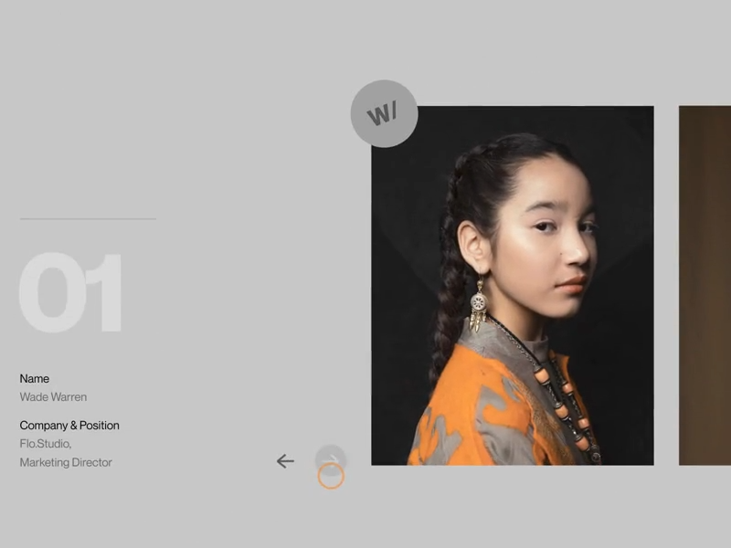
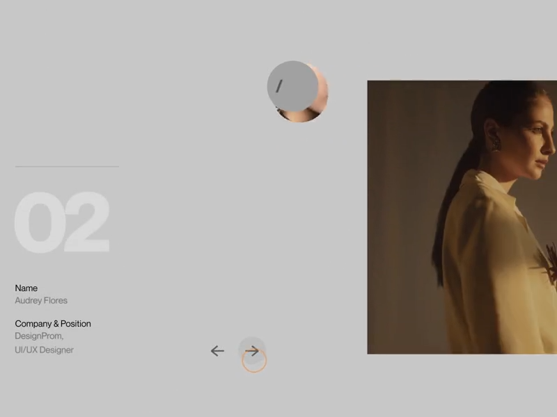
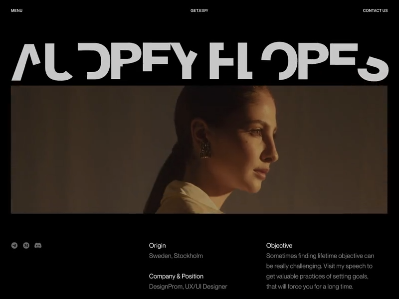
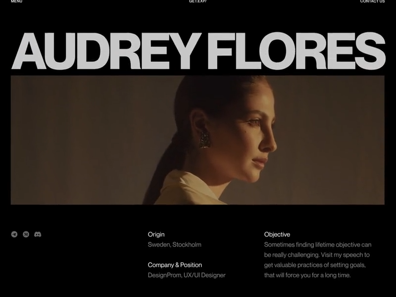

# Summit design inspiration

An evolving collection. On October 17, Alex selected the Zajno reference for the first implemented editorial/motion direction; later references can still refine it. Compare references by what they help an attendee do, not by how impressive their promotional videos look. The research below records the original inspection. See `src/summit/DESIGN.md` for the implemented design.

## Comparison index

| Reference | Strongest contribution | Best potential fit | Main tension | Status |
| --- | --- | --- | --- | --- |
| Zajno — Design Conference | Geometric continuity, coordinated composition, expressive type | Card-to-session navigation; editorial welcome and recap openings | Promotional spectacle versus fast conference utility | Selected and adapted October 17 |

For each new reference record: attribution and URLs; inspection method and limits; specific visual evidence; motion and layout principles; possible Summit applications; implementation/accessibility costs; unresolved questions. Keep observations separate from proposals. Add to this table before choosing a combined direction.

## 01 — Zajno: Design Conference

Reviewed October 17, 2026.

- [Design Conference Promo Animation](https://dribbble.com/shots/16788118-Design-Conference-Promo-Animation), **Vito Burhonski for Zajno**.
- [Design Conference Promo Page](https://dribbble.com/shots/16694082-Design-Conference-Promo-Page), **Sophie Tomash for Zajno**.
- [Original animation media](https://cdn.dribbble.com/userupload/34023828/file/large-72e0a9db8706a68d35281fe86c5cbe86.mp4).

### Evidence and limits

Opened both Dribbble pages in the browser. Inspected the original page's primary composition (not every gallery slide). Located and opened the actual 800 × 600, 22.73-second video, observed playback, then sought and examined decoded frames across its sequence, including intermediate masks and incomplete letters. The frame references below are video timestamps, not measured interaction durations.

This is an animated presentation, not a verified working website. Cursor movement, scrolling and hover-like changes are demonstrations inside that presentation. Mobile behavior, keyboard operation, responsive layout, actual scroll coupling and runtime performance are unverified. Sampled frames establish choreography; they do not establish exact easing curves or uninterrupted playback smoothness.

**Creator-reported:** Burhonski describes geometry-dependent photo reveals, letter-by-letter rendering, masks and trim paths in Adobe After Effects. Tomash describes a Figma design developed around layout, grid and building blocks. These are production descriptions, not evidence of a particular browser implementation.

### What is visually distinctive

The composition has two simultaneous scales: enormous tightly spaced headings and tiny, quiet labels. Portraits and horizontal photographic bands provide mass; large empty areas separate them from supporting facts. Thin rules and consistent alignments hold the asymmetric arrangement together. Near-black and gray sections establish chapters, while warm photographic colors supply most of the richness. The exact typeface is unconfirmed.

The empty space is active: the speaker number and metadata occupy the left, while a large portrait holds the right. A sliver of the next portrait suggests continuation. The circular initials badge overlaps the portrait boundary, connecting the picture to the interface. This is expressive placement within a stable grid, not arbitrary positioning.

The small labels and pale secondary text are much less transferable than the composition. A visitor between conference sessions needs room and time information to be prominent and readable.

### Motion evidence

| Clip position | Directly observed | Design reading |
| --- | --- | --- |
| About 2–3 s | Photographic windows widen inside a large sentence; surrounding spacing accommodates them | Imagery becomes punctuation within the typography |
| 5.5–7 s | Outgoing rectangular portrait contracts into a rounded remnant near its badge; incoming portrait moves into the established right-hand area; number, initials and metadata change | Different elements share one transition without all following the same trajectory |
| 8–9 s | Black bands crop the speaker view; a wide profile photograph appears in a dark composition | A geometric boundary marks a change in section and scale |
| 10–11 s | The name is assembled from partial strokes and displaced/rotated-looking letter segments before becoming complete | This is more intricate than a staggered character fade |
| 13–14 s | A curved gray region travels through a logo cell while adjacent cells remain fixed | A local effect gains impact from stable surroundings |
| 15–18 s | Ticket panels enter at different stages, settle into a grid, then one panel inverts its fill | Arrival choreography gives way to a quieter interaction state |
| 20–22.7 s | A horizontal shutter closes the ticket composition; the hero returns with incomplete letterforms that resolve | Geometric closure provides a transition between chapters |

Selected study frames, credited to Zajno and the creators above. These excerpts document the reference; they are not assets for the Summit site or a grant of reuse rights.

| Speaker before | Transition in progress |
| --- | --- |
|  |  |

| Letter construction | Settled composition |
| --- | --- |
|  |  |

### Why the choreography works

**Stable anchors make transformation legible.** The badge region, portrait area and metadata columns provide coordinates to follow. When the same speaker later occupies a wide profile image, their identity connects otherwise different compositions. The scene can change substantially without feeling unrelated.

**Geometry supplies the transition logic.** Rectangles, circles and shutters determine how images enter and leave. A reveal belongs to its shape rather than being a generic effect applied to every component. Letter construction follows the same principle at a smaller scale.

**Overlapping phases create one phrase.** Metadata replacement, image departure and image arrival overlap instead of waiting in a queue. Large transformations are separated by settled, readable compositions. The impression of polish comes partly from this alternation between motion and rest. Exact acceleration profiles cannot be recovered from the inspected samples.

**Contrast does the directing.** Changes in scale, negative space and light/dark fields concentrate attention. Animating everything would weaken this hierarchy. The most useful lesson is choosing what remains still.

### Translation to the current Summit

The current site already has a chronological card timeline, initial next-event positioning, previous summaries, a personal welcome, quick-jump dialog and mobile bottom navigation. It uses React, React Router, Tailwind and Motion for React; Summit styling is isolated in `src/summit/styles/summit.css`. The existing plum/lilac/green palette and soft cards are independent of this reference. This was the research baseline; the October 17 implementation now uses the editorial direction described in `src/summit/DESIGN.md`.

| Exploration | Where and why | Approach with existing stack | Cost and guardrails |
| --- | --- | --- | --- |
| **1. Continuous card-to-detail transition** | Preserve the selected session's identity as its card becomes a reading page | Motion layout/shared-element approach around the title block or a containing surface; coordinate secondary content with presence/variants | Medium–high: route lifetimes and scroll restoration need coordination. Prefer moving a text block over stretching glyphs. Long titles and different viewport sizes need fallbacks. Keep real links, Back behavior and focus management |
| **2. Editorial agenda grid** | Strengthen hierarchy without losing chronological scanning | Consistent time rail, title column and supporting metadata; allow keynote or recap imagery a deliberate larger slot using CSS Grid | Low–medium: change emphasis through scale and spacing, not scrambled order. Mobile becomes one reading column. Keep time and room visibly attached to every session |
| **3. One geometric reveal vocabulary** | A restrained portrait or recap image reveal can make opening a session feel authored | Start with a clipped wrapper, transform and opacity; consider a simple inset/ellipse mask only for an intentional focal image | Medium: masks may repaint. Avoid large layered masks, blur and dozens of simultaneous reveals. Reserve image dimensions and show a complete static state under reduced motion |
| **4. A composed quick-jump interaction** | Make moving through the agenda feel confident and easy to reach | Keep the current shortcut location; expand a compact surface into the picker, then dismiss it before moving to the chosen event | Medium: native dialog/focus lifecycle must remain reliable. Keyboard focus is explicit; no scroll hijacking or drag-only scrubber. Jump immediately under reduced motion |
| **5. Expressive introductory type** | Add personality to Alex's welcome or a recap heading | Test a short line reveal using overflow clipping and a small translation; keep content visible before enhancement | Low for lines; high for custom glyph construction. Do not animate essential session titles letter by letter. Decorative split text must not fragment screen-reader output |

### Proposed motion storyboard: open a session

This is a design hypothesis, not an implementation specification or a measurement of Zajno's clip.

1. **Acknowledge:** on activation, give the selected card a subtle pressed response. Its title, time and room remain readable.
2. **Carry:** the selected surface/title block moves toward the detail heading's position. Surrounding cards recede with a short fade. The selected content is the visual anchor; do not animate the entire timeline away in sequence.
3. **Resolve:** supporting detail appears as the heading settles, with only a small overlap between phases. Summary text does not wait for an ornamental intro.
4. **Return:** Back restores the original agenda position and the selected card's context. If a continuous reverse transition cannot be made reliable, use a short fade rather than a misleading flight to the wrong position.

Starting exploration ranges: 120–180 ms for local feedback; 300–450 ms total for navigation; at most 450–650 ms for an optional introductory flourish. Try a decelerating ease or a well-damped spring, with no overshoot on text. These are proposed tuning ranges, not extracted reference timings. Incoming content should begin before outgoing content finishes. Repeated use should feel faster than first arrival.

### Page load, scroll and mobile

- **Arrival:** establish the next event's position before revealing decorative details. Do not make the user travel from an animated hero to the useful card. Alex's note remains at the timeline's beginning, accessible by scrolling up and its shortcut.
- **Scroll:** preserve native movement. Restrict entrances to a small image or heading treatment; avoid replaying a full cascade when users rapidly scan up and down. Nothing essential should depend on an animation completing.
- **Current event:** emphasize with a stable visual treatment. A clock tick must not pull the reader away from earlier notes. Avoid pulsing reminders.
- **Mobile:** favor short translations, clear focus and reachable controls over panoramic photo morphs. Avoid hover-dependent content. Keep target sizes generous and retain the simple chronological reading order.
- **Reduced motion:** use immediate state changes or brief opacity changes, with identical content and navigation. Screen-reader and keyboard order must follow the document, not the visual choreography.

### Carry forward / hold back

Carry forward **identity-preserving transitions, disciplined asymmetry, a small set of geometric reveals, and coordinated motion with periods of rest**. These principles can support several future aesthetics, including warmer or more tactile directions.

Hold back the black-and-gray palette, extreme tiny-label hierarchy, full-screen shutters, custom cursor, long scroll performances and elaborate glyph masks. They serve this promotional composition, but could obstruct repeated use at a conference. Adobe After Effects trim-path effects should not become a reason to add a heavyweight animation pipeline.

### Questions for comparison with future references

- Can another reference bring warmth and tactility while retaining this compositional discipline?
- How much personality can live in the time rail, typography and spacing before adding photography?
- Should the focal object in navigation be the session title, the entire card, or a speaker image? Evaluate using real long titles and sessions without portraits.
- Can the useful next-event view feel special without any entrance animation?
- Which single signature transition would still feel pleasant on the tenth visit that day?

Next design step: compare additional references against these questions, then choose a small motion vocabulary and storyboard it with real Summit content. Alex subsequently authorized implementation on October 17, centered on the card-to-detail storyboard and editorial layout.
